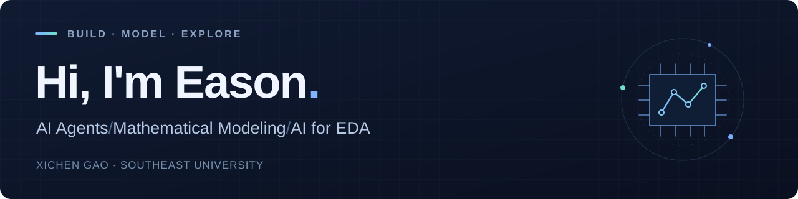

  

  <b>Xichen Gao · Eason</b> 
  Undergraduate in Integrated Circuits at <b>Southeast University</b> 
  Exploring how AI can turn ideas into models, working systems, and better designs.

  
  

---

### 🧭 Interests

| Direction | Questions I'm exploring |
| :--- | :--- |
| **AI Agents** | How can tools, context, and workflow design help agents carry out longer tasks reliably? |
| **Mathematical Modeling** | How can we translate real problems into models and check that their results make sense? |
| **AI for EDA** | How can learning methods help with chip placement while respecting circuit design constraints? |

### 🔭 Currently exploring

- **Math Model Agent** — developing a mathematical modeling assistant, with a focus on literature, model selection, computation, and reporting.
- **Agent systems** — studying how tools, context, feedback, and persistent state support longer workflows.
- **AI for EDA** — reading research on learning-based chip placement and connecting it with my Integrated Circuits background.

These are ongoing projects and areas of study. I share implementations and notes as they take shape.

### 🛠️ Working with

  
  
  
  

### 📌 Public projects

| Project | What you'll find |
| :--- | :--- |
| [**Chinese-Chess**](https://github.com/EasonGao0728/Chinese-Chess) | A Chinese chess implementation in C++. |
| [**lulu-codex-pet**](https://github.com/EasonGao0728/lulu-codex-pet) | Lulu, an animated companion for Codex. |

### 📚 Learning & notes

I use GitHub to document what I build, what I learn, and the questions I am still working through.

- **Agents:** context management, tool use, feedback, and reproducibility.
- **Modeling:** assumptions, numerical methods, validation, and scientific writing.
- **EDA:** chip placement, physical design, and learning-based optimization.

---

  <b>Build something. Understand it. Make it better.</b> 
  Open to conversations about agents, mathematical modeling, and AI for EDA.

